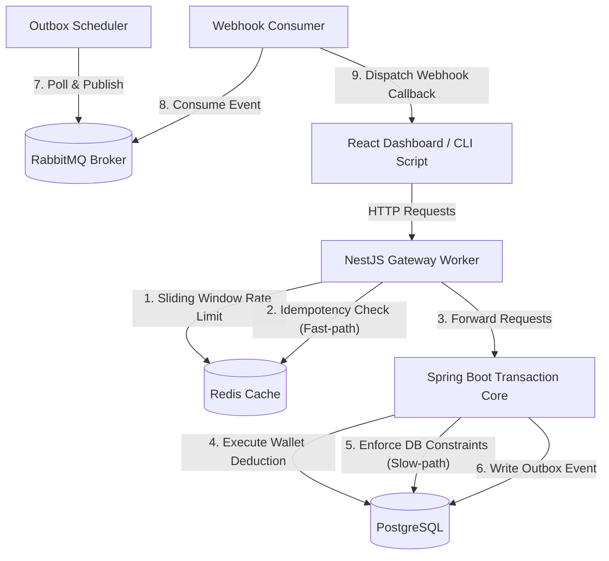

# Mock-Pay Concurrency & Idempotency Sandbox

A high-performance transaction processing sandbox designed to demonstrate distributed systems design patterns, race condition mitigation, and request idempotency protection.

This platform simulates a mock payment gateway utilizing a multi-layered defense architecture (Fast-path and Slow-path) to manage concurrent wallet deductions and prevent double-spending.

---

## System Architecture



---

## Key Technical Features

### 1. Concurrency Control (Wallet Deductions)
The system implements and compares three transaction processing strategies:
*   **Traditional (Race Condition)**: Demonstrates the classic read-calculate-write vulnerability where concurrent requests trigger overselling, leaving the business logic in an inconsistent state.
*   **Pessimistic Locking (`SELECT ... FOR UPDATE`)**: Guarantees consistency by locking rows sequentially, but causes database connection pool starvation under high latency.
*   **Atomic Conditional Update (Recommended)**: Utilizes database-level atomic operations (`UPDATE ... SET balance = balance - :amount WHERE balance >= :amount`) for lock-free, high-throughput execution.

### 2. Double-Spending Protection (Idempotency)
Implements a dual-layer idempotency guard:
*   **Fast-path (Redis Edge Guard)**: API Gateway intercepts requests using `X-Idempotency-Key` and Redis `SETNX` (60s TTL), blocking duplicate transactions in under 3ms without hitting the database.
*   **Slow-path (Database Unique Constraint)**: If the cache layer is bypassed, PostgreSQL enforces a `UNIQUE` constraint on `idempotency_key` inside the transaction boundary, acting as a final line of defense.

### 3. API Protection (Sliding Window Rate Limiter)
*   Protects backend resources from brute-force spamming using a Redis Hash sliding window counter.
*   Limits client requests to **1000 requests per minute** per Wallet ID / IP address with automatic memory cleanup.

### 4. Reliable Messaging (Transactional Outbox Pattern)
*   Avoids the "dual-write" problem by saving transaction records and outbox events in a single PostgreSQL transaction.
*   A background Spring Scheduler polls pending events every 1 second and publishes them to RabbitMQ.
*   A NestJS Webhook Worker consumes RabbitMQ messages and reliably dispatches event notifications back to client webhook URLs.

---

## Technology Stack

*   **Backend Core**: Java 21, Spring Boot 3.3.x (with Virtual Threads enabled), Spring Data JPA, Spring AMQP.
*   **API Gateway & Worker**: Node.js, NestJS 10, TypeScript, `ioredis`, `amqplib`.
*   **Frontend Dashboard**: React 18, Vite, Minimalist Zinc UI.
*   **Infrastructure**: PostgreSQL 15, Redis 7, RabbitMQ 3, Prometheus, Docker Compose.

---

## Quick Start Guide

### Prerequisites
Make sure you have **Docker Desktop**, **Node.js (v18+)**, and **Maven** installed.

### Step 1: Start Databases & Middleware
```bash
cd mock-pay-workspace
docker-compose up -d
```
This spins up PostgreSQL (port 5432), Redis (port 6379), and RabbitMQ (port 5672 & admin UI at 15672).

### Step 2: Run Spring Boot Backend
```bash
cd mock-pay-workspace/transaction-core-service
mvn spring-boot:run
```
*The core backend runs at `http://localhost:8080`.*

### Step 3: Run NestJS Gateway & Webhook Worker
```bash
cd mock-pay-workspace/gateway-worker-service
npm run start:dev
```
*The gateway service runs at `http://localhost:3000`.*

### Step 4: Start Developer Dashboard
```bash
cd mock-pay-workspace/developer-dashboard
npm run dev
```
*Access the UI at `http://localhost:5173`.*

---

## Simulation & Testing Scenarios

You can trigger tests directly from the **React Developer Dashboard** or execute the standalone Node.js scripts under the `mock-pay-workspace/stress-test` directory:

### Test Case 1: Overselling / Race Condition Test
Simulates 200 concurrent requests attempting to deduct 200,000 VND from a 1,000,000 VND wallet.
*   **Traditional**: Results in more than 5 successful transactions while the wallet balance is drained to 0, demonstrating business logic leakage.
*   **Pessimistic**: Exactly 5 transactions succeed, but execution duration increases significantly under simulated latency due to transaction queue blocking.
*   **Atomic**: Exactly 5 transactions succeed with minimal latency (<35ms), proving high performance and database safety.

```bash
cd mock-pay-workspace/stress-test
node overselling-test.js [traditional | pessimistic | atomic]
```

### Test Case 2: Idempotency Bypass Test
Simulates sending 200 concurrent requests with the same `X-Idempotency-Key`.
*   **Redis Guard (Fast-path)**: 1 succeeds, 199 are blocked by Redis Edge returning `409 Conflict` under 3ms.
*   **Bypass Redis (Slow-path)**: 1 succeeds, 199 are blocked by PostgreSQL unique index returning `500 Internal Server Error` (slow-path safety).

```bash
cd mock-pay-workspace/stress-test
node idempotency-test.js [bypass]
```
